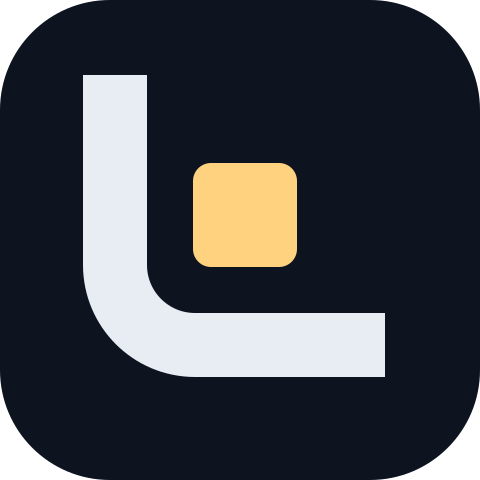

  

  <b>Een Nederlandse Minecraft-server met eigen gamemodes, eerlijke moderatie en een rustige, moderne uitstraling.</b>

  
  
  
  

  <a href="#-meteen-spelen">Spelen</a> ·
  <a href="#-gamemodes">Gamemodes</a> ·
  <a href="#-de-lobby">Lobby</a> ·
  <a href="#-community-en-moderatie">Community</a> ·
  <a href="#-wat-is-er-nu">Status</a> ·

---

## ✨ Wat is Lumen?

**Lumen** is een Minecraft-netwerk voor Nederlandse en Belgische spelers. Bijna alles maken we zelf: de lobby, de gamemodes, de moderatiewebsite en de Discord-bot. Zo past alles bij elkaar en kunnen we snel verbeteren wat spelers vragen.

Waar we voor gaan:

- **Eerlijk spelen.** Geen pay-to-win in de gamemodes, duidelijke regels en straffen die je kunt terugvinden.
- **Rust en overzicht.** Een nette huisstijl, overzichtelijke menu's en geen chat vol reclame.
- **Lang plezier.** Gamemodes met diepgang, waar je weken of maanden aan kunt werken.

> 🎁 **Eerste maand gratis VIP.** Speel je mee in de eerste maand na de opening? Dan krijg je 30 dagen VIP én de tag **[OG]** voor altijd.

---

## 🚀 Meteen spelen

| Wat | Waar |
|---|---|
| **Server-IP** | `play.lumenmc.nl` |
| **Versie** | Minecraft: Java Edition 26.3 |
| **Website** | [lumenmc.nl](https://lumenmc.nl) |
| **Discord** | via [discord.lumenmc.nl](https://discord.lumenmc.nl) |

1. Open Minecraft (Java Edition) en kies **Multiplayer**.
2. Klik op **Server toevoegen** en vul `play.lumenmc.nl` in.
3. Verbind en kies in de lobby met het kompas of een NPC je gamemode.

---

## 🎮 Gamemodes

<table>
  <tr>
    <td width="50%" valign="top">
      <h3>🏝️ Skyblock</h3>
      
Begin op een klein eiland in de leegte en bouw het uit tot het beste eiland van de server.

      <ul>
        <li>Eilanden met je vrienden, upgrades en een <b>ertsgenerator</b> die steeds beter wordt</li>
        <li><b>Gestapelde spawners</b> en <b>minions</b> die doorwerken terwijl je offline bent</li>
        <li>Eigen economie met shop, sell wands en een <b>veilinghuis</b></li>
        <li><b>25 ranks</b> om naartoe te werken, een questlijn en dagelijkse en wekelijkse missies</li>
        <li>Digitale crates, chattags, vliegtijd en een top 10 van eilanden</li>
      </ul>
    </td>
    <td width="50%" valign="top">
      <h3>⛓️ Prison Escape</h3>
      
Gevangenen proberen te ontsnappen, bewakers houden ze binnen. Een rollenspel met spanning.

      <ul>
        <li>Rollen: <b>Prisoner</b>, <b>Criminal</b>, <b>Guard</b> en één <b>Warden</b></li>
        <li>Guards klimmen op van level 1 tot 20 en openen steeds meer deuren</li>
        <li>Wapens, handboeien, fouilleren en een jail</li>
        <li>Huur je eigen cel, mijn erts en zoek loot in de gevangenis</li>
        <li>Ontsnap met escape-tools: kniptang, hamer en boor</li>
      </ul>
    </td>
  </tr>
</table>

> Meer gamemodes volgen. Ideeën? Laat het weten in onze Discord.

---

## 🌌 De lobby

Hier kom je binnen, en er is genoeg te doen:

| Functie | Wat je kunt doen |
|---|---|
| 🧭 **Serverselector** | Kompas en NPC's met live spelersaantallen, status en een slimme wachtrij |
| ⭐ **Levels & gold** | Verdien XP en gold door te spelen, met beloningen per level |
| 🎁 **Crates & daily** | Dagelijkse crate met streak, kansen altijd zichtbaar |
| 🎩 **Cosmetics** | Bijna 150 stuks: hoeden, deeltjes, trails, gadgets, pets en badges |
| 🛍️ **Shop** | Cosmetics kopen met gold, elke dag 3 aanbiedingen |
| 🚀 **Boosters** | Persoonlijke en netwerkbrede boosters voor XP en gold |

---

## 🤝 Community en moderatie

**Eerlijke moderatie.** Elke straf krijgt een eigen ID (bijvoorbeeld `B-7K2Q9X`). Die zie je op het banscherm en staff kan hem altijd terugvinden. Ons staffteam werkt met een eigen moderatiewebsite met bewijs, notities en een logboek, zodat niemand zomaar iets kan doen.

**Discord.** Onze Discord-bot regelt:

- verificatie tegen bots
- tickets voor vragen, reports en bezwaar tegen een straf
- het koppelen van je Minecraft-account (je in-game rank verschijnt dan ook op Discord)
- een live serverstatus

**Staffteam.**

| Leiding | Moderatie | Bouwen | Hulp |
|:---:|:---:|:---:|:---:|
| Owner · Manager | Sr. Admin · Admin · Sr. Mod · Mod | Sr. Builder · Builder | Sr. Helper · Helper |

### Huisregels in het kort

- Respect voor iedereen, geen haat, discriminatie of bedreigingen.
- Geen hacks, cheat-clients, exploits of macro's.
- Geen reclame voor andere servers.
- Eén account per persoon voor beloningen; geen alts om te farmen.
- Twijfel je? Vraag het aan staff of open een ticket.

---

## 📍 Wat is er nu?

| Onderdeel | Status |
|---|:---:|
| Lobby met selectors, wachtrij, levels, crates, cosmetics en shop | ✅ |
| Netwerk met lobbyrouting, wachtrij en onderhoud per server | ✅ |
| Skyblock | ✅ |
| Prison Escape | ✅ |
| Straffensysteem met ID's, gamemode-bans en waarschuwingen | ✅ |
| Moderatiewebsite voor staff | ✅ |
| Discord-bot (verificatie, tickets, koppelen, status, logs) | ✅ |
| Eigen resourcepack met iconen | ✅ |
| Officiële opening | 🔜 |
| Nieuwe gamemodes en events | 💡 |

✅ klaar · 🔜 binnenkort · 💡 idee

   
  <b>Lumen</b> · <a href="https://lumenmc.nl">lumenmc.nl</a> 
  Lumen is niet verbonden aan Mojang Studios of Microsoft. Minecraft is een handelsmerk van Mojang Studios.

